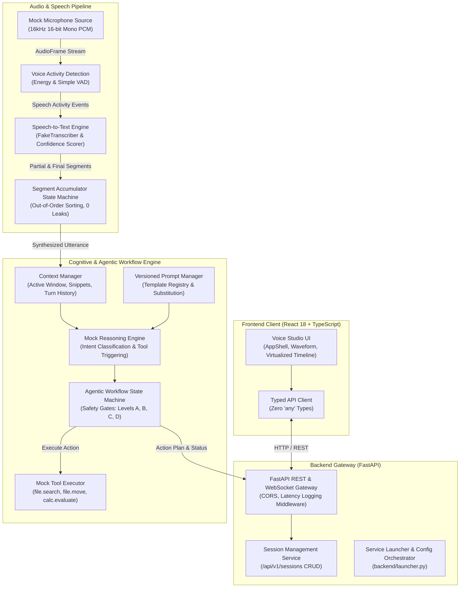

# SDK-9 — AcademiaAI Voicebot & Voice Co-Pilot

> **Team SDE-9** · Final Delivery: `projects/sde-9-voicebot/` (Branch: `team/sde-9-voicebot`)  
> Comprehensive voice-driven AI co-pilot designed for real-time speech interaction, contextual screen reasoning, multi-step agentic workflows, and safe action execution.

---

## 🏛️ High-Level System Architecture



---

## 📁 Monorepo Directory Structure

```
SDK-9/
├── backend/                               # FastAPI Backend Gateway (Apeksha KT)
│   ├── api/                               # Session endpoints (/api/v1/sessions)
│   ├── schemas/                           # Pydantic request & response schemas
│   ├── services/                          # In-memory session management service
│   ├── launcher.py                        # Service orchestrator (env & CLI flags)
│   ├── main.py                            # ASGI entrypoint with request logging
│   ├── README.md                          # Backend architecture & API documentation
│   └── tests/                             # Isolated backend test suite (98% coverage)
│
├── frontend/                              # Accessible React 18 UI (Spoorthi V)
│   ├── src/
│   │   ├── components/                    # AppShell, VoiceControls, TranscriptTimeline
│   │   ├── hooks/                         # useVoiceRecorder custom Web Speech hook
│   │   ├── api_client.ts                  # Strictly-typed API client (zero 'any')
│   │   ├── App.tsx                        # Enterprise Studio workspace
│   │   └── styles.css                     # Responsive WCAG 2.1 AA styling
│   ├── src/__tests__/                     # Vitest component & hook test suite (88% coverage)
│   ├── ACCESSIBILITY.md                   # Full WCAG 2.1 AA compliance audit report
│   ├── package.json                       # Frontend scripts & dependencies
│   ├── README.md                          # Frontend setup & architecture guide
│   └── vite.config.ts                     # Vite build & bundler configuration
│
├── packages/                              # Core Python Micro-Packages
│   │
│   ├── audio/                             # Audio Capture & VAD (Satwik A)
│   │   ├── mock_mic.py                    # 16-bit PCM streaming microphone simulator
│   │   ├── vad.py                         # Energy-based & simple Voice Activity Detectors
│   │   ├── cli.py                         # Real-time ASCII audio meter CLI demo
│   │   ├── models.py / schemas.py         # AudioConfig, AudioFrame, VADResult schemas
│   │   ├── types.ts                       # TypeScript audio definitions
│   │   ├── README.md                      # Audio pipeline documentation
│   │   └── tests/                         # Isolated audio unit & stress tests (96% coverage)
│   │
│   ├── speech_to_text/                    # Speech-to-Text & Accumulator (Pavanchand RM - Lead)
│   │   ├── fake_transcriber.py            # Simulated STT & dynamic confidence scoring
│   │   ├── accumulator.py                 # Streaming chunk accumulator state machine
│   │   ├── cli.py                         # Live streaming transcription CLI demo
│   │   ├── models.py                      # TranscriptSegment & AccumulatedUtterance models
│   │   ├── types.ts                       # TypeScript speech interfaces
│   │   ├── README.md                      # STT architecture & pipeline documentation
│   │   └── tests/                         # STT unit, integration & memory tests (99% coverage)
│   │
│   ├── context_reasoning/                 # Context & Reasoning (Praveen Kumar)
│   │   ├── context_manager.py             # Active window, screen & turn history manager
│   │   ├── prompt_manager.py              # Versioned prompt template registry
│   │   ├── mock_reasoning.py              # LLM intent classification & tool decision service
│   │   ├── models.py                      # ConversationContext & WindowContext schemas
│   │   ├── types.ts                       # TypeScript context definitions
│   │   ├── README.md                      # Context engine documentation
│   │   └── tests/                         # Isolated context reasoning tests
│   │
│   └── agentic_workflow/                  # Workflow & Tool Execution (Chiranthan RK)
│       ├── state_machine.py               # Multi-step decision FSM with safety gates (A–D)
│       ├── mock_executor.py               # Safe tool executor (file.search, file.move, calc)
│       ├── models.py                      # ActionPlan, WorkflowStep, ToolResult models
│       ├── types.ts                       # TypeScript workflow interfaces
│       ├── README.md                      # State machine transition & safety docs
│       └── tests/                         # Workflow unit & integration tests (126 tests, 99% coverage)
│
├── docs/                                  # Team Specifications & Contracts
│   ├── architecture.md                    # Core architectural standards
│   ├── integration-contracts.md           # Inter-module data contract definitions
│   └── development-workflow.md            # Git branching rules & PR checklist
│
├── tests/                                 # End-to-End Test Suite
│   ├── integration/                       # Reserved for Week 4 cross-module pipelines
│   └── README.md                          # Testing philosophy & isolation strategy
│
├── pyproject.toml                         # Monorepo build & package discovery configuration
└── requirements.txt                       # Python dependencies (FastAPI, Pydantic, Pytest, Uvicorn)
```

---

## 👥 Team Members & Module Ownership

| Member | Responsibility | Feature Branch | Test Coverage |
| :--- | :--- | :--- | :---: |
| **Pavanchand RM** *(Team Lead)* | Speech-to-Text & Segment Accumulator | `feature/speech-to-text` | **99%** |
| **Satwik A** | Audio Capture & Voice Activity Detection | `feature/audio-vad` | **96%** |
| **Chiranthan RK** | Agentic Workflow & Mock Tool Execution | `feature/agentic-workflow` | **99%** |
| **Apeksha KT** | Backend Gateway, Sessions & Launcher | `feature/backend-fastapi` | **98%** |
| **Spoorthi V** | Frontend UI, AppShell & Virtualized Timeline | `feature/frontend` | **88%** |
| **Praveen Kumar** | Context Tracking & Versioned Reasoning | `feature/context-reasoning` | In Progress |

---

## ⚡ Quickstart Guide

### 1. Prerequisites
- **Python**: Version 3.10+ (Recommended: Python 3.12)
- **Node.js**: Version 18+ (Recommended: Node 20 LTS)

### 2. Environment Setup

#### Clone the Repository:
```bash
git clone https://github.com/Tony-chopper1/SDK-9.git
cd SDK-9
```

#### Python Virtual Environment Setup:
```bash
# Create virtual environment:
python3 -m venv .venv

# Activate virtual environment:
source .venv/bin/activate       # On Linux / macOS
.venv\Scripts\activate          # On Windows (CMD)
.venv\Scripts\Activate.ps1      # On Windows (PowerShell)

# Install dependencies in editable mode:
pip install -r requirements.txt
pip install -e .
```

#### Frontend Dependencies:
```bash
cd frontend
npm ci
cd ..
```

---

## 🚀 Running the Services

### A. Start the Backend Gateway
```bash
# Using the dedicated service launcher:
python backend/launcher.py --port 8000 --reload

# Or directly with Uvicorn:
uvicorn backend.main:app --reload --port 8000
```
- **API Health**: `http://localhost:8000/api/v1/health`
- **Interactive Swagger Docs**: `http://localhost:8000/docs`

### B. Start the Frontend Studio
```bash
cd frontend
npm run dev
```
Open your browser at **`http://localhost:5173`** to access the voice studio interface.

### C. Run Standalone CLI Demos
Each micro-package provides an interactive terminal demonstration:

```bash
# Speech-to-Text & Streaming Accumulator Demo:
python -m packages.speech_to_text.cli

# Audio Capture & VAD Meter Demo:
python -m packages.audio.cli --iterations 10
```

---

## 🧪 Automated Testing Strategy

To ensure zero merge conflicts during parallel feature development, all unit tests are colocated within their respective module directories:

### Run Isolated Package Tests:
```bash
# Speech-to-Text:
pytest packages/speech_to_text/tests/ -v

# Audio & VAD:
pytest packages/audio/tests/ -v

# Agentic Workflow:
pytest packages/agentic_workflow/tests/ -v

# Backend Gateway:
pytest backend/tests/ -v

# Frontend Vitest Suite:
cd frontend && npm test -- --run
```

### Run Full Repository Test Suite:
```bash
pytest
```
*Currently passing **170+ tests** with comprehensive code coverage across all core modules.*

---

## 🌿 Git & Branching Strategy

- **`main`**: Production-ready, stable milestone releases.
- **`develop`**: Central integration branch for all verified feature PRs.
- **`feature/*`**: Individual developer branches created from `develop`.

> [!IMPORTANT]
> Never push directly to `develop` or `main`. All contributions must be submitted via Pull Requests targeting `develop` after passing all local test suites.
