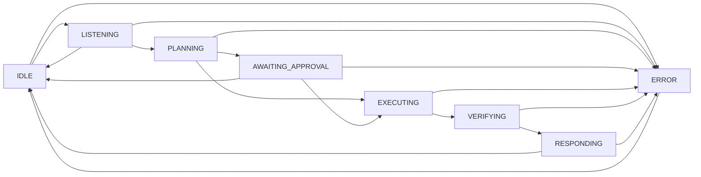

# Agentic Workflow Module (`packages/agentic_workflow/`)

> **Owner**: Chirantan R Kuppelur · Branch: `feature/chirantan-week2`  
> **Task**: W4 – Agentic Workflow: Validation, Tool Registry, Approvals & Safe Executor (Weeks 1 & 2)

---

## Overview

The `agentic_workflow` package provides the core orchestration layer for the SDK-9 AI Voice Co-Pilot. It implements:
- A finite-state machine governing the multi-step agent lifecycle.
- DAG dependency analysis with 3-color DFS cycle detection and topological sorting.
- An allow-listed tool registry with parameter schema validation and permission scope enforcement.
- Human-in-the-loop approval management with configurable TTL expiration.
- A resilient mock tool executor with per-step timeouts, bounded retries for idempotent actions, and safe cancellation.

---

## Module Structure

```
packages/agentic_workflow/
├── __init__.py          # Public API re-exports
├── models.py            # Pydantic data models, enums & schemas
├── validator.py         # DAG cycle detection & topological ordering
├── registry.py          # Allow-listed tool registry & permission scopes
├── approval.py          # Approval request lifecycle & TTL expiry
├── state_machine.py     # AgentStateMachine FSM & execute_plan DAG runner
├── mock_executor.py     # Resilient tool executor (timeouts, retries, cancel)
├── types.ts             # TypeScript interfaces mirroring all contracts
└── tests/
    ├── test_agentic_workflow.py        # Week 1 tests (126 tests)
    └── test_validation_and_safety.py   # Week 2 tests (33 tests)
```

---

## Week 2 Core Architecture

### 1. Plan Validation & DAG Dependency Analysis (`validator.py`)
- **Cycle Detection**: Validates prerequisites via 3-color (White, Gray, Black) DFS traversal. Detects self-dependencies ($A \rightarrow A$), two-node cycles ($A \rightarrow B \rightarrow A$), and multi-node cycles ($A \rightarrow B \rightarrow C \rightarrow A$), raising `CircularDependencyError` with the exact cycle path.
- **Missing Prerequisites**: Identifies unknown step IDs referenced in `depends_on`, raising `MissingDependencyError`.
- **Topological Ordering**: `PlanValidator.get_topological_order(plan)` returns step IDs sorted so all prerequisite actions complete before their dependents.

### 2. Allow-Listed Tool Registry & Permission Scopes (`registry.py`)
Only registered tools may be invoked. Each tool declares permission boundaries, parameter types, and idempotency:

| Tool Name       | Permission Scope  | Idempotent | Safety Level | Required Parameters   |
|-----------------|-------------------|------------|--------------|-----------------------|
| `file.search`   | `READ_ONLY`       | ✅ Yes     | Level A      | None (all optional)   |
| `file.move`     | `WORKSPACE_WRITE` | ❌ No      | Level C      | `source`, `destination` |
| `calc.evaluate` | `READ_ONLY`       | ✅ Yes     | Level A      | `expression`          |

- **Schema Validation**: Missing required parameters or type mismatches raise `ToolParameterError`.
- **Permission Scopes**: Calling without the required scope raises `PermissionDeniedError`. `SYSTEM_EXEC` and `WORKSPACE_WRITE` satisfy read requirements.

### 3. Approval Gate & TTL Expiration (`approval.py`)
- Gated by `ApprovalManager` for any plan with `requires_approval=True` (Safety Level C or D).
- Supports configurable TTL (e.g. 300s). Once `time.time() > expires_at`, the request transitions to `EXPIRED`.
- **Non-negotiable Rule**: `is_execution_permitted(plan)` returns `True` **strictly only if** the plan has been explicitly approved and has not expired. Rejected or expired plans will **never** execute tools.

### 4. Resilient Tool Executor (`mock_executor.py`)
- **Timeouts**: Per-step `timeout_seconds` limits execution duration.
- **Bounded Retries**: Idempotent tools (`file.search`, `calc.evaluate`) are retried up to 3 times with exponential backoff on transient errors.
- **Retry Suppression**: Non-idempotent tools (`file.move`) fail fast on the first failure to prevent duplicate side-effects.
- **Cancellation**: `cancel()` cooperatively halts pending and in-flight executions.

### 5. State Machine Integration (`state_machine.py`)
- `build_plan(..., validate=True)` automatically runs `PlanValidator`.
- `execute_plan()` verifies approvals, computes the DAG topological order, invokes tools via `MockToolExecutor`, and advances state transitions through `VERIFYING` $\rightarrow$ `RESPONDING` $\rightarrow$ `IDLE`.

---

## Safety Levels

| Level | Label         | Approval Required | Typical Actions                         |
|-------|---------------|-------------------|-----------------------------------------|
| **A** | Informational | ❌ Auto-approved  | Read files, search, query               |
| **B** | Low Risk      | ❌ Auto-approved  | Write logs, send notifications          |
| **C** | Sensitive     | ✅ Required       | Edit configuration, move/rename files   |
| **D** | Destructive   | ✅ Required       | Delete files, drop databases, overwrite |

---

## State Machine Transition Diagram



---

## Code Examples

### 1. Build & Execute a DAG Action Plan

```python
from packages.agentic_workflow import (
    AgentStateMachine,
    AgentState,
    WorkflowStep,
    SafetyLevel,
    PermissionScope,
)

sm = AgentStateMachine()
sm.transition_to(AgentState.LISTENING)
sm.transition_to(AgentState.PLANNING)

# Step 1: Search files
s1 = WorkflowStep(
    id="step-search",
    step_number=1,
    description="Search python files",
    tool_name="file.search",
    safety_level=SafetyLevel.A,
    parameters={"pattern": "*.py", "directory": "/src"},
)

# Step 2: Depends on step-search
s2 = WorkflowStep(
    id="step-calc",
    step_number=2,
    description="Calculate stats",
    tool_name="calc.evaluate",
    safety_level=SafetyLevel.A,
    depends_on=["step-search"],
    parameters={"expression": "10 * 5"},
)

# Validates DAG and transitions to EXECUTING
plan = sm.build_plan(session_id="sess-01", goal="Search & calculate", steps=[s2, s1])
assert sm.state == AgentState.EXECUTING

# Executes in topological order (step-search then step-calc)
sm.execute_plan(granted_scopes=[PermissionScope.READ_ONLY])
assert sm.state == AgentState.IDLE
```

### 2. Approval Gate with TTL Expiry

```python
from packages.agentic_workflow import (
    AgentStateMachine,
    AgentState,
    WorkflowStep,
    SafetyLevel,
    ApprovalManager,
)

sm = AgentStateMachine()
sm.transition_to(AgentState.LISTENING)
sm.transition_to(AgentState.PLANNING)

s_move = WorkflowStep(
    id="step-move",
    step_number=1,
    description="Move sensitive logs",
    tool_name="file.move",
    safety_level=SafetyLevel.C,
    parameters={"source": "/logs/app.log", "destination": "/archive/app.log"},
)

plan = sm.build_plan(session_id="sess-02", goal="Archive log file", steps=[s_move])
assert sm.state == AgentState.AWAITING_APPROVAL

# Managed approval gate
mgr = ApprovalManager(default_ttl_seconds=300.0)
req = mgr.create_request(plan.plan_id, "sess-02", SafetyLevel.C)
mgr.approve(req.request_id, decided_by="sec-admin", reason="Authorized maintenance")

sm.approve_plan()
sm.execute_plan(approval_manager=mgr)
```

---

## Testing & Coverage

Run the comprehensive test suite:

```bash
# Agentic workflow suite with coverage
.venv/bin/pytest --cov=packages/agentic_workflow packages/agentic_workflow/tests/ -v

# Full monorepo suite
.venv/bin/pytest
```

### Test Results

```
============================= 159 passed in 2.05s =============================
packages\agentic_workflow\__init__.py                     100%
packages\agentic_workflow\approval.py                      93%
packages\agentic_workflow\mock_executor.py                 85%
packages\agentic_workflow\models.py                       100%
packages\agentic_workflow\registry.py                      98%
packages\agentic_workflow\state_machine.py                 93%
packages\agentic_workflow\validator.py                     96%
packages\agentic_workflow\tests\test_agentic_workflow.py  100%
packages\agentic_workflow\tests\test_validation_and_safety.py 100%
------------------------------------------------------------------
TOTAL COVERAGE: 97%
```

Monorepo full test suite: **266 passed, 0 failures**.
