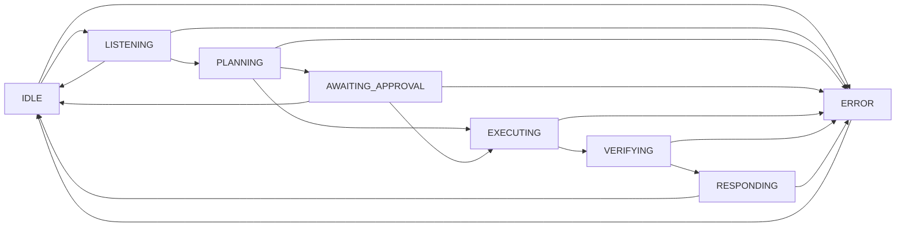

# Agentic Workflow Module (`packages/agentic_workflow/`)

> **Owner**: Chirantan R Kuppelur · Branch: `feature/agentic-workflow`  
> **Task**: W4 – Agentic Workflow: Schemas, State Machine & Harmless Mock Tool Executor (Week 1)

---

## Overview

The `agentic_workflow` package provides the core orchestration layer for the SDK-9 AI Voice Co-Pilot. It implements:
- Standardized domain schemas: `WorkflowPlan`, `WorkflowStep`, `ToolSpec`, `ApprovalRequest`, and `WorkflowResult`.
- A finite-state machine that governs multi-step agentic decisions and transitions.
- A safety-classification gate (Levels A to D) enforcing human approval for sensitive/destructive operations.
- A strictly harmless mock tool execution engine with exactly two harmless tools (`file.search` and `calc.evaluate`). Consequential tools like `file.move` or external network dispatch have been removed to prevent side-effects.

---

## Module Structure

```
packages/agentic_workflow/
├── __init__.py          # Public API re-exports
├── models.py            # WorkflowPlan, WorkflowStep, ToolSpec, ApprovalRequest, WorkflowResult
├── state_machine.py     # AgentStateMachine FSM with safety gate
├── mock_executor.py     # MockToolExecutor (harmless mock tools)
├── types.ts             # TypeScript interfaces mirroring all schemas
└── tests/
    └── test_agentic_workflow.py  # Unit + integration test suite (129 tests, 99% coverage)
```

---

## Standard Schemas

| Schema | Purpose | Key Attributes |
|---|---|---|
| **`WorkflowPlan`** | Multi-step agentic execution plan | `plan_id`, `session_id`, `goal`, `steps`, `overall_safety_level`, `requires_approval`, `approved_at`, `rejected_at`, `rejection_reason` |
| **`WorkflowStep`** | Discrete action step in a plan | `id`, `step_number`, `description`, `tool_name`, `parameters`, `safety_level`, `status`, `retry_count`, `execution_logs` |
| **`ToolSpec`** | Specification of an authorized tool | `name`, `description`, `safety_level`, `is_idempotent`, `parameters`, `required_parameters` |
| **`ApprovalRequest`** | Human-in-the-loop approval contract | `request_id`, `plan_id`, `session_id`, `safety_level`, `status`, `expires_at`, `decided_at`, `decided_by`, `reason` |
| **`WorkflowResult`** | Standard result of tool execution | `tool_name`, `success`, `output`, `duration_ms`, `error`, `timestamp` |

> *Note: For backwards compatibility with initial starter code, aliases `ActionPlan = WorkflowPlan` and `ToolResult = WorkflowResult` are provided.*

---

## Harmless Mock Tools

Per safety requirements, consequential operations (such as file moving/renaming, disk modifications, or external communications) have been removed. Exactly two harmless in-memory mock tools are registered:

1. **`file.search`** (`SafetyLevel.A`, Informational):
   - Harmless, read-only simulation of glob directory scanning.
   - Parameters: `pattern` (str, default: `*`), `directory` (str, default: `/`), `max_results` (int, default: 10).
   - Generates simulated mock path strings without touching the physical filesystem.

2. **`calc.evaluate`** (`SafetyLevel.A`, Informational):
   - Safely parses and evaluates basic arithmetic expressions via AST.
   - Parameters: `expression` (str, required).
   - Supported operators: `+`, `-`, `*`, `/`, `//`, `%`, `**`, unary `+`/`-`, numbers.
   - Purely in-memory with zero external side-effects.

---

## Safety Levels & Approval Gate

Every step is tagged with a `SafetyLevel`:

| Level | Label         | Approval Required | Typical Actions                         |
|-------|---------------|-------------------|-----------------------------------------|
| **A** | Informational | ❌ Auto-approved  | Search, calculate, read visible info    |
| **B** | Low Risk      | ❌ Auto-approved  | Status query, harmless notifications    |
| **C** | Sensitive     | ✅ Required       | Modify configuration, write records     |
| **D** | Destructive   | ✅ Required       | Delete records, privileged actions      |

### Gate Logic:
- If all steps are **Level A or B** $\rightarrow$ `requires_approval=False`, transitions immediately to `EXECUTING`.
- If any step is **Level C or D** $\rightarrow$ `requires_approval=True`, transitions to `AWAITING_APPROVAL`.

---

## State Machine



---

## Code Example

```python
from packages.agentic_workflow import (
    AgentStateMachine,
    AgentState,
    WorkflowStep,
    SafetyLevel,
    MockToolExecutor,
)

# 1. Initialize State Machine
sm = AgentStateMachine()
sm.transition_to(AgentState.LISTENING)
sm.transition_to(AgentState.PLANNING)

# 2. Build Plan with Harmless Mock Tool
step = WorkflowStep(
    step_number=1,
    description="Calculate sales tax",
    tool_name="calc.evaluate",
    safety_level=SafetyLevel.A,
    parameters={"expression": "250 * 0.08"},
)

plan = sm.build_plan(session_id="sess-01", goal="Tax calculation", steps=[step])
assert sm.state == AgentState.EXECUTING

# 3. Execute with Mock Tool Executor
executor = MockToolExecutor()
result = executor.execute(step.tool_name, step.parameters)
assert result.success is True
assert result.output["result"] == 20.0

# 4. Complete Lifecycle
sm.transition_to(AgentState.VERIFYING)
sm.transition_to(AgentState.RESPONDING)
sm.transition_to(AgentState.IDLE)
```

---

## Testing & Coverage

```bash
# Run unit and integration tests with coverage
.venv/bin/pytest --cov=packages/agentic_workflow packages/agentic_workflow/tests/test_agentic_workflow.py -v
```

### Coverage Report:

```text
Name                                                       Stmts   Miss  Cover
------------------------------------------------------------------------------
packages\agentic_workflow\__init__.py                          4      0   100%
packages\agentic_workflow\mock_executor.py                    68      2    97%
packages\agentic_workflow\models.py                           82      0   100%
packages\agentic_workflow\state_machine.py                    80      0   100%
packages\agentic_workflow\tests\test_agentic_workflow.py     621      0   100%
------------------------------------------------------------------------------
TOTAL                                                        855      2    99%

129 passed in 1.24s (99% coverage)
```
