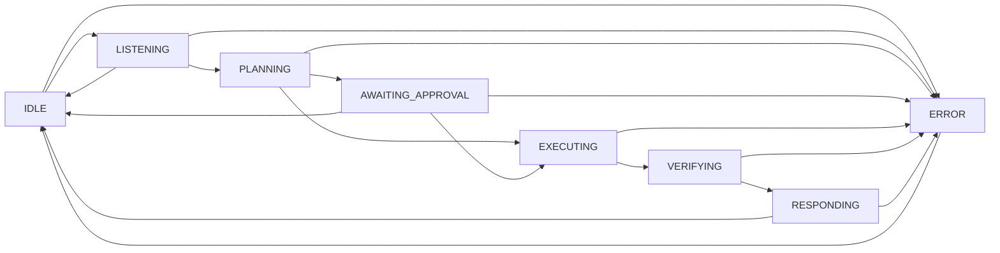

# Agentic Workflow Module (`packages/agentic_workflow/`)

> **Owner**: Chirantan R Kuppelur · Branch: `feature/agentic-workflow`  
> **Task**: W4 – Agentic Workflow: Workflow Schemas, State Machine & Mock Tool Executor

---

## Overview

The `agentic_workflow` package provides the core orchestration layer for the SDK-9 AI Voice Co-Pilot. It implements a finite-state machine that governs multi-step agentic decisions, a safety-classification gate that enforces human approval for high-risk actions, and a mock tool executor for integration testing and local development.

---

## Module Structure

```
packages/agentic_workflow/
├── __init__.py          # Public API re-exports
├── models.py            # Pydantic data models & enums
├── state_machine.py     # AgentStateMachine FSM
├── mock_executor.py     # MockToolExecutor (simulated tools)
├── types.ts             # TypeScript interfaces (frontend contract)
└── tests/
    └── test_agentic_workflow.py  # Full unit + integration suite (126 tests, 99% coverage)
```

---

## Safety Levels

Every `WorkflowStep` is tagged with a `SafetyLevel` that determines whether human approval is required before the plan executes.

| Level | Label         | Approval Required | Typical Actions                         |
|-------|---------------|-------------------|-----------------------------------------|
| **A** | Informational | ❌ Auto-approved  | Read files, search, query               |
| **B** | Low Risk      | ❌ Auto-approved  | Write logs, send notifications          |
| **C** | Sensitive     | ✅ Required       | Edit configuration, send emails         |
| **D** | Destructive   | ✅ Required       | Delete files, drop databases, overwrite |

### Safety Gate Rule

When `build_plan()` is called:
- If **all** steps are level **A** or **B** → `requires_approval=False`, machine transitions to **EXECUTING**.
- If **any** step is level **C** or **D** → `requires_approval=True`, `overall_safety_level` is set to the **most severe level present**, and the machine transitions to **AWAITING_APPROVAL**.

---

## State Machine

### States

| State               | Description                                          |
|---------------------|------------------------------------------------------|
| `IDLE`              | Default resting state, awaiting input                |
| `LISTENING`         | Actively receiving voice/text input                  |
| `PLANNING`          | Building an `ActionPlan` from a goal + steps         |
| `AWAITING_APPROVAL` | Blocked on human approval (C/D safety levels present)|
| `EXECUTING`         | Running workflow steps via tool executor             |
| `VERIFYING`         | Checking execution results                           |
| `RESPONDING`        | Formulating and delivering the final response        |
| `ERROR`             | Unrecoverable failure captured; awaiting reset       |

### Transition Diagram



---

## API Reference

### `AgentStateMachine`

```python
from packages.agentic_workflow import AgentStateMachine, AgentState, WorkflowStep, SafetyLevel

sm = AgentStateMachine()
print(sm.state)  # AgentState.IDLE
```

#### `transition_to(new_state, metadata=None)`
Validate and perform a state transition. Raises `InvalidTransitionError` for illegal transitions.

#### `can_transition_to(target) -> bool`
Return `True` if the target state is reachable from the current state.

#### `build_plan(session_id, goal, steps) -> ActionPlan`
Build an `ActionPlan` from a list of `WorkflowStep` objects and apply the safety gate. **Must be called in `PLANNING` state.**

#### `approve_plan() -> ActionPlan`
Approve the pending plan and transition to `EXECUTING`. **Must be in `AWAITING_APPROVAL`.**

#### `reject_plan(reason) -> ActionPlan`
Reject the pending plan, mark all pending steps as `"rejected"`, and return to `IDLE`. **Must be in `AWAITING_APPROVAL`.**

#### `handle_error(error_message) -> dict`
Transition to `ERROR` state and return recovery metadata dict with `error_message`, `previous_state`, `timestamp`, and `plan_id`.

#### `reset()`
Recover from `ERROR` → `IDLE`. Clears `current_plan` and `error_context`. **Must be in `ERROR`.**

#### `get_transition_history() -> list[tuple[str, str, float]]`
Return chronological list of `(from_state, to_state, timestamp)` tuples.

---

## Mock Tool Executor

### Registered Tools

| Tool Name       | Description                                   |
|-----------------|-----------------------------------------------|
| `file.search`   | Simulated directory scan; returns mock paths  |
| `file.move`     | Simulated file move with source/destination validation |
| `calc.evaluate` | Safe arithmetic expression evaluator          |

All tools return a `ToolResult` with `success`, `output`, `duration_ms`, `error`, and `timestamp`.

### `file.search` Parameters

| Parameter     | Type  | Default | Description                            |
|---------------|-------|---------|----------------------------------------|
| `pattern`     | `str` | `"*"`   | Glob pattern (e.g. `"*.py"`)           |
| `directory`   | `str` | `"/"`   | Root directory to scan                 |
| `max_results` | `int` | `10`    | Maximum number of results to return    |

### `file.move` Parameters

| Parameter     | Type   | Required | Description                          |
|---------------|--------|----------|--------------------------------------|
| `source`      | `str`  | ✅       | Absolute source path                 |
| `destination` | `str`  | ✅       | Absolute destination path            |
| `overwrite`   | `bool` | ❌       | Whether to overwrite destination     |

### `calc.evaluate` Parameters

| Parameter    | Type  | Required | Description                          |
|--------------|-------|----------|--------------------------------------|
| `expression` | `str` | ✅       | Arithmetic expression (e.g. `"2+3*4"`) |

Supported operators: `+`, `-`, `*`, `/`, `//`, `%`, `**`, unary `-`/`+`, integer/float literals.

### Error Simulation Mode

```python
executor = MockToolExecutor(simulate_failure=True)
result = executor.execute("file.search", {"pattern": "*.py"})
assert result.success is False
assert "simulated" in result.error.lower()
```

---

## Code Examples

### 1. Safe Plan (Level A/B → auto-executes)

```python
from packages.agentic_workflow import (
    AgentStateMachine, AgentState, WorkflowStep, SafetyLevel
)
from packages.agentic_workflow.mock_executor import MockToolExecutor

sm = AgentStateMachine()
sm.transition_to(AgentState.LISTENING)
sm.transition_to(AgentState.PLANNING)

step = WorkflowStep(
    step_number=1,
    description="Find Python files",
    tool_name="file.search",
    safety_level=SafetyLevel.A,
    parameters={"pattern": "*.py", "directory": "/src"},
)

plan = sm.build_plan(session_id="sess-1", goal="List all Python files", steps=[step])
assert sm.state == AgentState.EXECUTING  # Auto-proceeded

executor = MockToolExecutor()
for s in plan.steps:
    result = executor.execute(s.tool_name, s.parameters)
    s.status = "completed" if result.success else "failed"
    s.result = result.output

sm.transition_to(AgentState.VERIFYING)
sm.transition_to(AgentState.RESPONDING)
sm.transition_to(AgentState.IDLE)
```

### 2. Sensitive Plan (Level C/D → awaits approval)

```python
from packages.agentic_workflow import AgentStateMachine, AgentState, WorkflowStep, SafetyLevel

sm = AgentStateMachine()
sm.transition_to(AgentState.LISTENING)
sm.transition_to(AgentState.PLANNING)

step = WorkflowStep(
    step_number=1,
    description="Delete old log files",
    tool_name="file.move",
    safety_level=SafetyLevel.D,
    parameters={"source": "/logs/old.log", "destination": "/archive/old.log"},
)

plan = sm.build_plan(session_id="sess-2", goal="Archive old logs", steps=[step])
assert sm.state == AgentState.AWAITING_APPROVAL  # Needs human OK

# Human approves:
sm.approve_plan()
assert sm.state == AgentState.EXECUTING

# Or human rejects:
# sm.reject_plan("Security policy violation")
```

### 3. Error Recovery

```python
sm = AgentStateMachine()
sm.transition_to(AgentState.LISTENING)

meta = sm.handle_error("Unexpected NullPointerException in tool router")
print(meta["previous_state"])  # "LISTENING"
print(sm.state)                # AgentState.ERROR

sm.reset()
print(sm.state)                # AgentState.IDLE — ready to retry
```

### 4. Calculator Tool

```python
from packages.agentic_workflow.mock_executor import MockToolExecutor

executor = MockToolExecutor()
result = executor.execute("calc.evaluate", {"expression": "100 * 0.85 + 5"})
print(result.output["result"])   # 90.0
print(result.duration_ms)        # e.g. 0.12
```

---

## Testing & Coverage

```bash
# Run only agentic_workflow tests with coverage report
.venv/bin/pytest --cov=packages/agentic_workflow packages/agentic_workflow/tests/ -v

# Run full project test suite
.venv/bin/pytest
```

Current results:

| Module              | Statements | Covered | Coverage |
|---------------------|-----------|---------|----------|
| `models.py`         | 59        | 59      | **100%** |
| `state_machine.py`  | 80        | 80      | **100%** |
| `mock_executor.py`  | 73        | 71      | **97%**  |
| `__init__.py`       | 4         | 4       | **100%** |
| **Total**           | **798**   | **796** | **99%**  |

---

## TypeScript Interface Contract

The file [`types.ts`](./types.ts) defines matching TypeScript interfaces for all Python models, enabling type-safe API response handling in the React frontend:

```typescript
import type { ActionPlan, WorkflowStep, SafetyLevel, AgentState, ToolResult } from './types';

// Example: render plan approval UI
function renderApprovalBanner(plan: ActionPlan) {
  if (plan.requires_approval) {
    return `⚠️ Plan requires approval (Safety Level ${plan.overall_safety_level})`;
  }
  return "✅ Plan auto-approved and executing";
}
```

---

## Git Workflow

```
Repository: https://github.com/Yashuudevang/acd_voicebot
Branch: feature/agentic-workflow
Base: develop
```

Commits follow [Conventional Commits](https://www.conventionalcommits.org/):
- `feat(workflow):` for new features
- `fix(workflow):` for bug fixes
- `test(workflow):` for tests
- `docs(workflow):` for documentation
