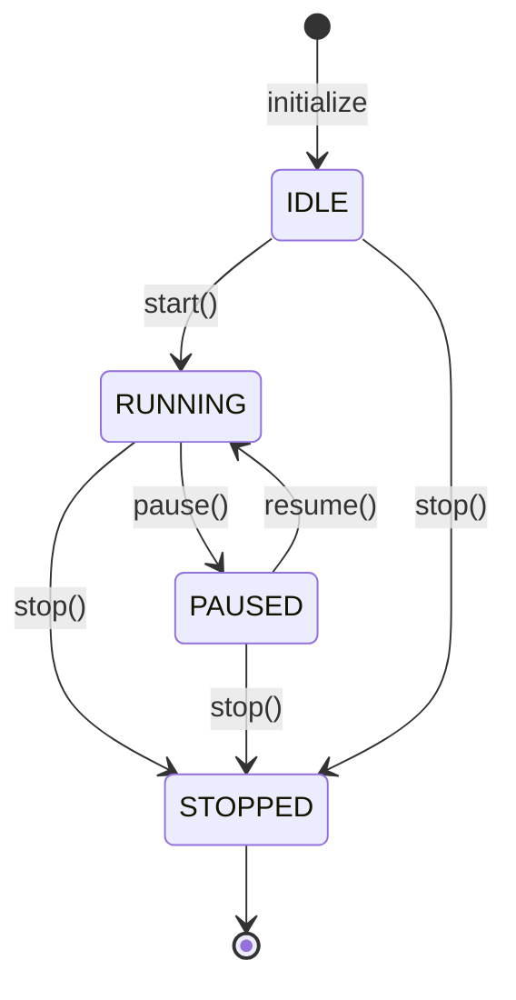

# Audio & Voice Activity Detection (VAD) Module

**Owner**: Satwik A (`feature/audio-vad`)  
**Team**: SDE-9 / SDK-9 Voicebot  
**Module**: `packages/audio/`  
**Current Milestone**: Week 2 (Days 8–14: Device States, Lifecycle, VAD Interface & Bounded Buffer)

---

## 1. Overview & Architectural Role

The **Audio & VAD** module is the ingress foundation of the SDK-9 AI Voice Co-Pilot pipeline. It captures and streams discrete audio frames, handles device discovery and permission lifecycles, performs Voice Activity Detection (VAD) to differentiate speech from background silence/noise, and regulates real-time stream flow via a bounded backpressure buffer.

The entire module is 100% offline, deterministic, and hardware-independent, requiring zero physical audio devices or proprietary cloud keys.

### Key Capabilities
- **Typed Configurations & Frames**: Strongly validated audio parameters (sample rate, bit depth, channel count, frame duration) and immutable frame models (`AudioConfig`, `AudioFrame`).
- **Hardware-Agnostic Device Adapter**: Abstract `AudioDeviceAdapter` and `MockAudioDeviceAdapter` supporting device enumeration, device selection, and permission states (`GRANTED`, `DENIED`, `UNAVAILABLE`, `PROMPT`).
- **Stream Lifecycle Controller**: Thread-safe `StreamLifecycleController` managing state transitions (`start`, `pause`, `resume`, `stop`), preventing invalid transitions (`InvalidStateTransitionError`), and tracking skipped frames during pause.
- **Enhanced VAD Interface**: Pluggable `BaseVAD` abstract contract with deterministic `MockVAD` and zero-dependency `EnergyVAD` featuring configurable dBFS thresholds and `min_speech_duration_ms` filtering to eliminate click false-positives.
- **Bounded Audio Stream Buffer**: Thread-safe `BoundedAudioBuffer` with configurable capacity (`max_frames`, `max_duration_ms`), backpressure strategies (`DROP_OLDEST`, `DROP_NEWEST`, `BLOCK`), and telemetry (`frames_dropped`, `bytes_dropped`).
- **Robustness Against Stream Faults**: Tested tolerance for frame sequence gaps, jitter/out-of-order chunks, bursty arrivals, ambient noise, and graceful thread shutdown.
- **Contract & Envelope Compliance**: 100% compliant with SDK-9 event and error envelope specifications in `docs/integration-contracts.md`.
- **Interactive CLI Demo**: Terminal utility demonstrating device selection, permission simulation, lifecycle transitions, VAD classification, and buffer telemetry.

---

## 2. Implementation Language & Architectural Rationale

* **Language**: Python ($\ge 3.10$)
* **Location**: `packages/audio/` (configured on `pythonpath` in `pyproject.toml`)
* **Rationale**:
  1. The SDK-9 repository is structured as a unified Python monorepo (`pyproject.toml`, `requirements.txt`).
  2. Sibling consumer modules—specifically Speech-to-Text (`packages/speech_to_text/`) and the FastAPI backend (`backend/`)—are written in Python. Python schemas enable direct, zero-overhead in-process imports (`from audio.schemas import AudioFrame`).
  3. The automated test harness across the repository is `pytest`.
  4. The schemas provide Pydantic v2-compatible methods (`model_dump()`, `model_validate()`) while running with zero external dependencies to ensure full portability across development environments.
  5. *TypeScript Support*: `packages/audio/types.ts` provides strongly typed TypeScript definitions corresponding 1:1 with Python Pydantic models in `models.py`.

---

## 2.1 Python & TypeScript Schema Correspondence

The TypeScript definitions in `packages/audio/types.ts` mirror the Python Pydantic models in `packages/audio/models.py`:

| Python Model (`models.py`) | TypeScript Definition (`types.ts`) | Data / Wire Type Mapping | Field Semantics & Contract Notes |
| :--- | :--- | :--- | :--- |
| `AudioFormat(BaseModel)` | `interface AudioFormat` | `sample_rate: number`<br>`bit_depth: number`<br>`channels: number`<br>`format: string` | Format specification schema. Base class for `AudioConfig`. |
| `AudioConfig(AudioFormat)` | `interface AudioConfig` | Extends `AudioFormat`<br>`frame_duration_ms: number` | Stream configuration. Defaults: 16 kHz, 16-bit PCM, mono. `frame_duration_ms=30` is baseline; `20` is provisional STT. |
| `AudioFrame(BaseModel)` | `interface AudioFrame` | `data`: `Uint8Array \| ArrayBuffer \| string`<br>`timestamp`: `number` (epoch sec)<br>`sample_rate`: `number`<br>`frame_index`: `number`<br>`is_speech`: `boolean`<br>`timestamp_ms`: `number` (stream ms)<br>`timestamp_utc`: `string` (ISO 8601) | Discrete audio frame. Python `bytes` corresponds to `Uint8Array` in JS/TS or `base64` string in JSON serialization. |
| `AudioChunk(AudioFrame)` | `interface AudioChunk` | Extends `AudioFrame`<br>`chunk_id?: string`<br>`chunk_index?: number` | Canonical schema for discrete audio chunks, interoperable with `AudioFrame`. |
| `VADState(str, Enum)` | `const VADState = { ... } as const`<br>`type VADState` | `string` union: `'SILENCE' \| 'SPEECH_START' \| 'SPEECH' \| 'SPEECH_END'` | Identical enum values for tracking speech/silence transition states. |
| `VADResult(BaseModel)` | `interface VADResult` | `is_speech: boolean`<br>`confidence: number`<br>`energy_db: number`<br>`metadata?: Record<string, unknown>` | Frame classification result with confidence score in `[0.0, 1.0]` and dBFS level. |
| `VADEvent(BaseModel)` | `interface VADEvent` | `state: VADState`<br>`timestamp: number`<br>`energy_level: number`<br>`confidence: number`<br>`frame_index?: number`<br>`timestamp_ms?: number` | Internal VAD detection event tracking state transitions (`SILENCE`, `SPEECH_START`, `SPEECH`, `SPEECH_END`). |
| `EventEnvelope(BaseModel)` | `interface EventEnvelope<T>` | `event_id: string`<br>`event_type: string`<br>`schema_version: string`<br>`session_id: string`<br>`correlation_id: string`<br>`timestamp: string`<br>`producer: string`<br>`payload: T` | Shared SDK-9 event envelope conforming to `docs/integration-contracts.md`. Produced via `vadEvent.to_envelope()`. |

### Timestamp Semantics in Both Languages
- **`timestamp`** (`float` in Python / `number` in TypeScript): Unix epoch wall-clock timestamp in fractional seconds (e.g. `1730304000.123`).
- **`timestamp_ms`** (`float` in Python / `number` in TypeScript): Audio-relative stream offset in milliseconds advancing monotonically from `0.0` (e.g. `0.0, 20.0, 40.0`).
- **`timestamp_utc`** (`str` in Python / `string` in TypeScript): Wall-clock UTC timestamp in ISO 8601 format (e.g. `'2026-10-30T14:30:00.000000+00:00'`).

### Approved Team Defaults vs. Provisional STT Contract
- **Approved Team Baseline**: 16,000 Hz, 16-bit PCM (`s16le`), Mono (1 channel), **30 ms** frame duration (**960 bytes** per frame).
- **Provisional STT Contract**: **20 ms** frame duration (**640 bytes** per frame), with provisional fields `audio_data`, `sequence_number`, and `timestamp_ms` supported for downstream transcription compatibility. Marked as provisional pending Week 2 joint testing.

---

## 3. Audio & Frame Contract (Provisional STT Interface)

> [!NOTE]
> **Provisional Status**: The audio interface below was proposed by the Speech-to-Text developer (Pavan) and implemented in `packages/audio/`. It is currently documented as **provisional** pending joint integration testing and team-lead review.

### Contract Parameters
- **Sample Rate**: 16,000 Hz (`16 kHz`)
- **Channels**: 1 (Mono)
- **Sample Format**: Signed 16-bit little-endian PCM (`s16le`)
- **Internal Payload**: Raw Python `bytes` (`audio_data`)
- **Default Frame Duration**: 20 ms
- **Supported Frame Durations**: 20 ms and 30 ms

### Expected Payload Sizes
- **20 ms Frame**: **640 bytes** ($16000 \times 0.020 \times 1 \times 2$)
- **30 ms Frame**: **960 bytes** ($16000 \times 0.030 \times 1 \times 2$)

### Frame Data Structure (`AudioFrame`)
Every frame produced by the audio module exposes the agreed fields:

| Field Name | Type | Description |
| :--- | :--- | :--- |
| `audio_data` | `bytes` | Raw 16-bit PCM byte payload (`s16le`). |
| `sample_rate` | `int` | Sampling frequency in Hz (default: `16000`). |
| `channels` | `int` | Number of channels (default: `1` for mono). |
| `format` | `str` | Audio encoding format (default: `"s16le"`). |
| `frame_duration_ms` | `int` | Duration of discrete frame in ms (`20` or `30`). |
| `sequence_number` | `int` | Zero-based, monotonically increasing index preserving temporal order. |
| `timestamp_ms` | `float` | Audio-relative timeline position advancing by frame duration (e.g. `0.0, 20.0, 40.0`). |
| `frame_id` | `str` | Unique frame identifier string (e.g. `frame-a1b2c3d4e5`). |
| `timestamp_utc` | `str` | ISO 8601 wall-clock UTC timestamp for logging/auditability. |

---

### 3.1 Deterministic Mock Microphone (Review Feedback)

To eliminate run-to-run variations in automated test suites and downstream benchmarking:
- **Deterministic Mathematical Waveforms**: Audio synthesis in `_generate_pcm_samples()` uses analytical multi-harmonic trigonometric equations ($f_0$ carrier and modulation envelope) rather than floating noise, guaranteeing reproducible PCM byte payloads.
- **Configurable Seed (`seed: int = 42`)**: Eliminates non-deterministic system PRNG states. Provides seed-based frame ID generation (`frame-{sha256(seed:counter)[:10]}`) and an isolated instance PRNG (`self._rng = random.Random(seed)`).
- **Fixed Default Epoch (`start_timestamp: float = 1793491200.0`)**: Defaults to `2026-11-01T00:00:00.000000+00:00` UTC. Timestamps advance deterministically by frame duration without querying `datetime.now()` or the system clock.
- **Identical Outputs**: Two independent `MockMicrophoneSource` instances initialized with the same configuration and seed produce bit-for-bit identical audio payloads, metadata, and serialized dictionary outputs.

---

## 4. End-of-Stream (EOS) Specification

To ensure clear stream termination across module boundaries:

1. **EOF Return Value**:
   - `AudioSource.read_frame()` returns `None` when the stream concludes or when maximum duration is reached.
2. **Clean Generator Termination**:
   - `AudioSource.stream()` cleanly raises `StopIteration` without emitting extra frames.
3. **Empty Frames Prohibited**:
   - Empty audio frames (`audio_data=b""` or truncated byte length) are **strictly rejected** during `AudioFrame` validation with an `AudioFrameValidationError`.
   - An empty frame is never used as an EOF sentinel.

---

## 5. Device Adapter & Permission States (Days 8–9)

The `AudioDeviceAdapter` abstraction decouples audio capture from physical hardware. The `MockAudioDeviceAdapter` simulates hardware discovery, selection, and OS-level permission lifecycles without sound cards.

### Permission States (`PermissionState`)
- `GRANTED`: Capture permitted; audio source creation succeeds.
- `DENIED`: User or system blocked access; source creation raises `DevicePermissionError`.
- `UNAVAILABLE`: Device physically missing, disconnected, or locked by another app; raises `DevicePermissionError`.
- `PROMPT`: Awaiting user interaction; raises `DevicePermissionError` until state resolves to `GRANTED`.

### Device Discovery & Selection
```python
from audio.device import MockAudioDeviceAdapter, PermissionState

adapter = MockAudioDeviceAdapter()

# 1. List available devices
devices = adapter.list_devices()
# [DeviceInfo(device_id="mock-default-mic", name="Default Microphone", is_default=True), ...]

# 2. Select a specific device
adapter.select_device("mock-usb-headset")

# 3. Simulate permission check
status = adapter.get_permission_status()
if status != PermissionState.GRANTED:
    adapter.request_permission()

# 4. Create source (returns AudioSource abstraction)
source = adapter.create_source(pattern="speech", duration_seconds=2.0)
```

---

## 6. Stream Lifecycle Management (Days 10–11)

The `StreamLifecycleController` provides safe, deterministic state management for audio streaming pipelines.



### Lifecycle States (`StreamState`)
- `IDLE` (or alias `READY`): Controller initialized with device/source configuration; ready for start.
- `RUNNING`: Active frame capture; frames are dispatched to downstream consumers.
- `PAUSED`: Frame acquisition paused; incoming frames are skipped and accounted for in `frames_paused_dropped`.
- `STOPPED`: Terminal state; underlying source is safely closed and resources released.
- `ERROR`: Pipeline encountered an unhandled fault; source cleaned up automatically.

### Rejection of Invalid Transitions
Calling transitions out of order (e.g. `resume()` while in `IDLE`, or `start()` when `STOPPED`) immediately raises an `InvalidStateTransitionError` with the SDK-9 error envelope (`AUDIO_INVALID_STATE_TRANSITION`).

### Lifecycle Example
```python
from audio.device import MockAudioDeviceAdapter
from audio.lifecycle import StreamLifecycleController

adapter = MockAudioDeviceAdapter()
source = adapter.create_source(pattern="speech", duration_seconds=5.0)

with StreamLifecycleController(source=source) as controller:
    controller.start()

    # Process some frames
    frame1 = controller.read_frame()

    # Temporarily mute / pause
    controller.pause()
    assert controller.state.value == "PAUSED"

    # Resume streaming
    controller.resume()
    frame2 = controller.read_frame()

    controller.stop()
```

---

## 7. Voice Activity Detection (VAD) Enhancements (Days 10–11)

The VAD interface provides configurable energy thresholding and minimum speech duration filtering to prevent false activations from brief clicks or environmental spikes.

### VAD Configuration
```python
from audio.vad import EnergyVAD

vad = EnergyVAD(
    threshold_db=-38.0,            # Configurable sensitivity threshold (dBFS)
    min_speech_duration_ms=60.0,   # Requires 60ms of continuous energy before confirming SPEECH
    hangover_frames=3,             # Maintains speech state over short inter-syllable pauses
    trigger_frames=2,              # Mitigates impulsive single-frame spikes
)

result = vad.process_frame(frame)
print(result.is_speech, result.energy_db, result.confidence)
```

---

## 8. Bounded Audio Stream Buffer (Days 12–13)

The `BoundedAudioBuffer` provides thread-safe producer-consumer queueing between audio ingress and downstream consumers (e.g., Speech-to-Text).

### Backpressure Strategies (`BackpressureStrategy`)
- `DROP_OLDEST`: When buffer is full, discards the oldest queued frame to make room for newest. Ideal for real-time low-latency voice bots.
- `DROP_NEWEST`: Discards the newly incoming frame when capacity is reached. Preserves historical audio context.
- `BLOCK`: Blocks the producer thread until consumer drains space or timeout expires.

### Telemetry & Buffer Operations
```python
from audio.buffer import BoundedAudioBuffer, BackpressureStrategy

# Bounded by 10 frames (~200ms of audio)
buffer = BoundedAudioBuffer(
    max_frames=10,
    strategy=BackpressureStrategy.DROP_OLDEST,
)

# Producer thread
buffer.put(frame)

# Consumer thread
frame = buffer.get(timeout_ms=50.0)

# Real-time Telemetry
telemetry = buffer.get_telemetry()
print(f"Current frames : {telemetry.current_frames}/{telemetry.max_frames}")
print(f"Dropped frames : {telemetry.frames_dropped}")
print(f"Dropped bytes  : {telemetry.bytes_dropped}")
print(f"High watermark : {telemetry.high_watermark_frames}")

# Graceful termination
buffer.close()
```

---

## 9. Robustness & Fault Tolerance (Day 14)

The audio module includes comprehensive robustness testing (`tests/test_robustness.py`):
1. **Audio Gaps & Missing Frames**: Downstream pipelines detect sequence number jumps (`seq=0 -> seq=3`) while timestamps maintain monotonically advancing stream offsets.
2. **Late & Out-of-Order Chunks**: Frames can be sorted or ingested deterministically using sequence numbers and timestamps.
3. **Noise & Impulse Bursts**: Short clicks (e.g. single 20ms burst) are suppressed by `min_speech_duration_ms` filtering, preventing spurious speech events.
4. **Bursty Irregular Arrivals**: Bounded buffer absorbs producer bursts and cleanly drains without data loss or memory leaks.
5. **Frame Durations Interoperability**: Seamless support for both 20ms (640 bytes) and 30ms (960 bytes) frame payloads.
6. **Graceful Shutdown**: Calling `buffer.close()` immediately releases any blocked producer or consumer threads without deadlocks.

---

## 10. CLI Demonstration Tool

The interactive CLI demo showcases the entire pipeline: device selection, permissions, lifecycle states, VAD detection, and buffer backpressure telemetry.

```bash
# 1. Device selection and custom pattern
python packages/audio/cli.py --device mock-usb-headset --pattern alternating --duration 2.0

# 2. Simulate permission denial
python packages/audio/cli.py --permission DENIED

# 3. Interactive lifecycle state demonstration (READY -> START -> PAUSE -> RESUME -> STOP)
python packages/audio/cli.py --demo-lifecycle --iterations 15

# 4. Bounded buffer backpressure demonstration
python packages/audio/cli.py --buffer-size 5 --buffer-strategy DROP_OLDEST --iterations 12

# 5. Real-time microphone pacing with 30ms frames
python packages/audio/cli.py --frame-ms 30 --duration 2.0 --realtime
```

### Sample CLI Lifecycle Output
```text
====================================================================
  SDK-9 AI Voice Co-Pilot — Audio & VAD Module Demonstration
====================================================================
  Device        : Mock USB Headset (mock-usb-headset) [GRANTED]
  Configuration : 16000 Hz, 16-bit PCM, Mono, 20ms frames
  Buffer Config : capacity=5 frames, strategy=DROP_OLDEST
  Lifecycle Mode: ENABLED (Demonstrating START -> PAUSE -> RESUME -> STOP)
  Mock Source   : pattern='alternating', iterations=15, real_time=False
  VAD Engine    : ENERGY (threshold: -42.0 dBFS, min_duration: 60.0ms)
--------------------------------------------------------------------
  [LIFECYCLE] Controller initialized. State: READY
  [LIFECYCLE] Starting audio stream. State: STREAMING
  SEQ   TIME_MS   UTC_TIME        RMS     dBFS    METER                 STATE      BUF
--------------------------------------------------------------------------------------
  0000       0ms  19:00:00.000     8418.3   -11.8  [==============    ]   [SILENCE]  [1/5]
  0001      20ms  19:00:00.020     9109.1   -11.1  [===============   ]   [SILENCE]  [2/5]
  0002      40ms  19:00:00.040     9372.6   -10.9  [===============   ]   [SPEECH]   [3/5]
  [LIFECYCLE] Pausing audio stream for 3 frames...
  [LIFECYCLE] Stream paused. State: PAUSED (Skipped frames while paused: 3)
  [LIFECYCLE] Resuming audio stream... State: STREAMING
  0006     120ms  19:00:00.120     9372.6   -10.9  [===============   ]   [SPEECH]   [4/5]
...
  [LIFECYCLE] Stopping audio stream... State: STOPPED
--------------------------------------------------------------------
Pipeline Summary:
  Total frames processed : 12
  Speech frames detected : 8 (66.7%)
  Frames skipped (pause) : 3
  Buffer Drops (frames)  : 0
  Buffer Drops (bytes)   : 0 B
  Buffer High Watermark  : 4 frames
  Sample Event Envelope  : ID=evt-7c9403f98e44, Version=1.0.0
====================================================================
Demo completed successfully.
```

---

## 11. Error Envelopes & Diagnostics

All module errors adhere to the SDK-9 structured error envelope in `docs/integration-contracts.md`:

```json
{
  "code": "AUDIO_LIFECYCLE_INVALID_TRANSITION",
  "message_safe_for_user": "Cannot pause stream: stream is in 'STOPPED' state, expected 'STREAMING'.",
  "retryable": false,
  "correlation_id": null,
  "details_redacted": {
    "current_state": "STOPPED",
    "target_action": "pause"
  }
}
```

### Module Error Codes
| Exception Class | Error Code (`code`) | Description |
| :--- | :--- | :--- |
| `AudioConfigError` | `AUDIO_CONFIG_INVALID` | Invalid audio parameter (e.g. invalid sample rate or frame duration). |
| `AudioFrameValidationError` | `AUDIO_FRAME_INVALID` | Frame byte length or parameter mismatch (rejects empty frames). |
| `AudioSourceError` | `AUDIO_SOURCE_ERROR` | Audio source reading failure or closed stream access. |
| `AudioDeviceError` | `AUDIO_DEVICE_ERROR` | Base hardware adapter or device error. |
| `DeviceNotFoundError` | `AUDIO_DEVICE_NOT_FOUND` | Specified device ID does not exist. |
| `DevicePermissionError` | `AUDIO_DEVICE_PERMISSION_DENIED`| Capture denied or device unavailable. |
| `StreamLifecycleError` | `AUDIO_LIFECYCLE_ERROR` | Base stream lifecycle failure. |
| `InvalidStateTransitionError`| `AUDIO_LIFECYCLE_INVALID_TRANSITION` | Attempted illegal state transition. |
| `BufferError` | `AUDIO_BUFFER_ERROR` | Buffer operation on closed buffer or invalid bounds. |
| `VADError` | `AUDIO_VAD_ERROR` | VAD configuration or classification failure. |

---

## 12. Test Execution & Coverage

Tests are executed with `pytest`:

```bash
# Run complete audio test suite
pytest packages/audio

# Run complete audio test suite with coverage report
pytest packages/audio --cov=packages/audio --cov-report=term-missing
```

### Test Suite Structure
1. **Week 1 Baseline Tests** (32 tests):
   - `tests/unit/test_audio_schemas.py`: Configuration validation, frame sizing math (640B and 960B), rejection of empty frames as EOS, error envelopes, serialization, and `AudioFormat`/`AudioChunk` schema inheritance parity.
   - `tests/unit/test_mock_mic.py`: Strict determinism verification across independent runs, deterministic byte reproduction, seed-based ID generation, stream generators, pattern switching, explicit EOF return (`None`).
   - `tests/unit/test_vad.py`: `MockVAD` scripting, `EnergyVAD` speech/silence separation, hangover smoothing.
   - `tests/unit/test_audio_cli.py`: Meter rendering, fast execution, error exit handling, main entrypoint.
   - `tests/integration/test_audio_pipeline.py`: Full end-to-end stream $\rightarrow$ VAD $\rightarrow$ Event envelope pipeline for 20ms and 30ms frames.
2. **Week 2 Device & Lifecycle Tests** (24 tests):
   - `tests/test_device.py` (14 tests): Device enumeration, selection, permission states (`GRANTED`, `DENIED`, `UNAVAILABLE`, `PROMPT`), source creation guardrails, and error envelopes.
   - `tests/test_lifecycle.py` (10 tests): Full state machine validation, valid transitions, invalid transition rejection, repeated start/stop, rapid pause/resume, skipped frame accounting, and context manager exits.
3. **Week 2 VAD & Buffer Tests** (17 tests):
   - `tests/test_vad_enhancements.py` (4 tests): Configurable energy thresholds, `min_speech_duration_ms` filtering, short noise rejection, and backwards compatibility.
   - `tests/test_buffer.py` (13 tests): Backpressure strategies (`DROP_OLDEST`, `DROP_NEWEST`, `BLOCK`), capacity limits, 20ms and 30ms byte boundaries, multithreaded producer-consumer coordination, slow consumers, and stream generators.
4. **Day 14 Robustness Tests** (7 tests):
   - `tests/test_robustness.py` (7 tests): Audio sequence gaps, out-of-order jitter, ambient noise vs clicks vs speech, bursty arrivals, 20ms/30ms interoperability, and unblocking of threads on buffer closure.

**Total**: 110 tests passing, $\ge 95\%$ test coverage across `packages/audio/`.
