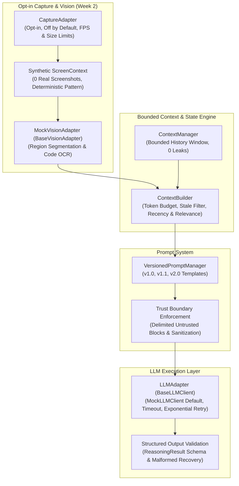

# Context & Reasoning Module

The **Context & Reasoning** module establishes multimodal context tracking, opt-in screen capture with sampling/size bounds, deterministic OCR vision processing, bounded context budgeting, versioned prompt template management, and resilient LLM client execution for the SDK-9 AI Voice Co-Pilot.

---

## 🏛️ Architecture & Component Overview



---

## 📦 Core Components & Domain Schemas

### 1. Domain Models (`models.py` & `types.ts`)
- **`ScreenContext`**:
  - Captures screen frames or visual context.
  - **Privacy-first**: `capture_enabled` defaults to `False` (opt-in only).
  - Deterministic synthetic test frame generator: `ScreenContext.create_synthetic(width, height, pattern, ...)`.
- **`CaptureConfig`**: Governs opt-in state, sampling rate limit (`max_fps`), dimension limits (`max_width`, `max_height`), and byte limits (`max_bytes`).
- **`VisionRegion` & `VisionResult`**: Segmented screen UI regions (editor, terminal, title bar) and OCR extraction result with calibrated confidence and latency.
- **`ContextBuilderConfig`**: Bounded context parameters: `token_budget` (approx. tokens), `stale_threshold_seconds` (item TTL), `screen_stale_seconds`, and `relevance_threshold`.
- **`ContextItem` & `SourceReference`**: Discrete context items with explicit trust boundary tags (`is_trusted=False` for untrusted external data).
- **`ReasoningRequest` & `ReasoningResult`**: Strictly validated request and structured decision models.
- **`LLMResponse`**: Standardized response container with parsed JSON, validated Pydantic model, latency metrics, and retry telemetry.

### 2. Opt-in Capture Adapter (`capture_adapter.py`)
- **Privacy Policy**: Screen capture is strictly opt-in and **disabled by default** (`CaptureDisabledError` raised if attempted when disabled).
- **Sampling Frequency Limits**: Enforces `max_fps` (e.g., 2.0 FPS). Throttled requests raise `SamplingRateLimitError` or return cached frames with `throttle_cached=True`.
- **Dimension and Byte Limits**: Proportional downscaling when `downscale_on_overflow=True`; enforces strict `max_bytes` byte-payload caps with `FrameSizeLimitError`.
- **Zero Real Screenshots**: Exclusively uses deterministic synthetic test patterns.

### 3. OCR and Vision Adapter (`vision_adapter.py`)
- **`BaseVisionAdapter`**: Abstract interface declaring `process_frame`, `extract_text`, and `detect_regions`.
- **`MockVisionAdapter`**: Deterministic simulation of OCR text extraction and UI region detection (code editor, terminal console, title bar) with latency tracking and configurable failure injection.

### 4. Bounded Context Builder (`context_builder.py`)
- **Token-Budget Approximation**: Approximates tokens (~4 characters/token) and enforces strict upper bound (`token_budget`).
- **Stale Filtering**: Filters out context items and screen frames exceeding time-to-live thresholds.
- **Recency & Relevance Scoring**: Evaluates keyword term overlap (`score_relevance`) and exponential age decay (`score_recency`), weighting trusted system items higher.
- **Sliding History Selection**: Preserves chronological order while selecting the most recent turns within history allowance.

### 5. Resilient LLM Adapter (`llm_adapter.py`)
- **`BaseLLMClient` & `MockLLMClient`**: Default offline mock client generating deterministic JSON responses without external keys or network calls.
- **Timeout Enforcement**: Enforces per-call timeout (`LLMTimeoutError`).
- **Exponential Backoff Retry**: Automatically retries transient errors with configurable backoff factor and retry limits (`LLMRetryExhaustedError`).
- **Structured Output Validation**: Validates model output against Pydantic schemas (e.g., `ReasoningResult`). Malformed JSON, missing fields, or invalid types raise `MalformedOutputError`.
- **Graceful Fallback Mode**: Optional `fallback_on_failure=True` yields safe, nominal responses under critical failures.

---

## ⚡ Quickstart & Usage

### End-to-End Pipeline:
```python
from packages.context_reasoning import (
    CaptureAdapter,
    CaptureConfig,
    MockVisionAdapter,
    ContextBuilder,
    ContextBuilderConfig,
    LLMAdapter,
    ReasoningResult,
    ContextManager,
)

# 1. Capture synthetic screen frame (opt-in enabled)
capture = CaptureAdapter(CaptureConfig(capture_enabled=True, max_fps=2.0))
frame = capture.capture_frame(width=1280, height=720, visible_text="def add(a, b): return a + b")

# 2. Extract OCR and UI regions
vision = MockVisionAdapter()
vision_result = vision.process_frame(frame)

# 3. Assemble bounded context
cm = ContextManager("session-001")
cm.update_active_window("VS Code", "math.py", visible_snippet=vision_result.extracted_text)
raw_context = cm.update_user_query("Calculate 25 * 4")

builder = ContextBuilder(ContextBuilderConfig(token_budget=1024))
bounded_request = builder.build_context(raw_context)

# 4. Invoke LLM with retries and structured validation
llm = LLMAdapter()
prompt = f"Query: {bounded_request.query}\nContext: {bounded_request.context.active_window.visible_snippet}"
response = llm.invoke(prompt, schema=ReasoningResult)

result: ReasoningResult = response.structured_data
print(f"Intent: {result.intent}, Planned Tool: {result.planned_tool_name}")
```

---

## 🧪 Testing & Quality Assurance

Run the test suite across both Week 1 and Week 2:
```bash
pytest packages/context_reasoning/tests/
```

With code coverage:
```bash
pytest --cov=packages.context_reasoning packages/context_reasoning/tests/
```

**Metrics**:
- **92 Passing Unit & Integration Tests** (31 new Week 2 tests).
- **97% Code Coverage** across all package modules.
- **Malformed-output tests pass**: Verifies unparseable JSON, missing required fields, and type violations are caught or safely recovered.
- Entire monorepo test suite passes (**357 passed**).
