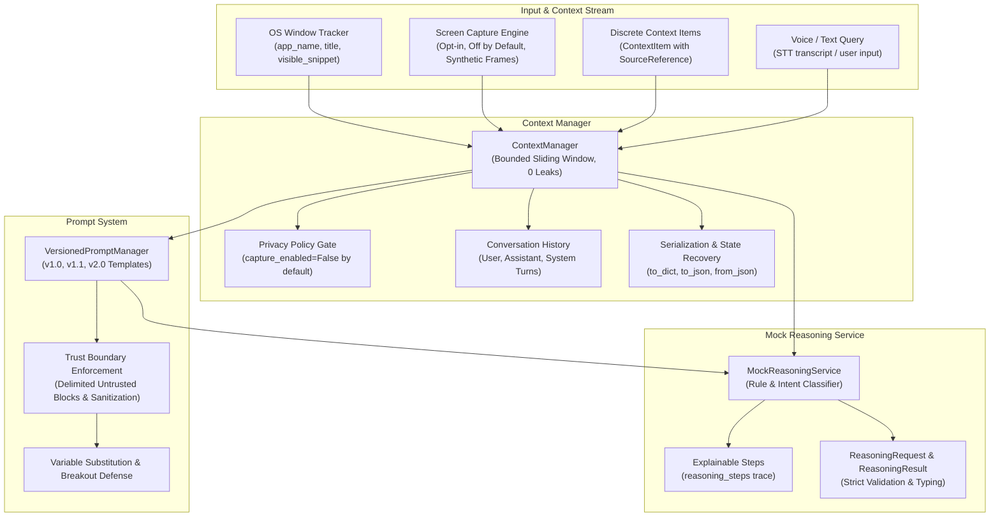

# Context & Reasoning Module

The **Context & Reasoning** module establishes multimodal context tracking, versioned prompt template management, and simulated LLM decision-making for the SDK-9 AI Voice Co-Pilot.

---

## 🏛️ Architecture & Component Overview



---

## 📦 Core Components & Domain Schemas

### 1. Domain Models (`models.py` & `types.ts`)
- **`ScreenContext`**:
  - Captures screen frames or visual context.
  - **Privacy-first**: `capture_enabled` defaults to `False` (opt-in only).
  - Deterministic synthetic test frame generator: `ScreenContext.create_synthetic(width, height, pattern, ...)`.
- **`ContextItem`**:
  - Discrete context unit supplied to reasoning (`item_id`, `item_type`, `content`, `source`, `is_trusted`, `timestamp`).
  - Explicit trust boundary flag (`is_trusted=False` for external/user data).
- **`SourceReference`**:
  - Origin and provenance tracking (`source_id`, `source_type`, `title`, `uri`, `is_trusted`, `timestamp`).
- **`ReasoningRequest`**:
  - Typed input payload sent to reasoning (`session_id`, `query`, `context`, `context_items`, `screen_context`, `prompt_version`, `temperature`).
  - Validates non-empty `session_id`, non-empty `query`, and bounded `temperature` (0.0 to 2.0).
- **`ReasoningResult`**:
  - Structured decision output (`intent`, `requires_tool`, `planned_tool_name`, `tool_parameters`, `direct_response`, `confidence`, `reasoning_steps`).
  - Validates non-empty `intent` and calibrated `confidence` (0.0 to 1.0).
- **`WindowContext`**: Tracks active operating system window context (e.g. `VS Code`, `Chrome`), focused file titles, application category, and visible code/document snippets.
- **`ConversationTurn`**: Represents an individual dialogue turn (`user`, `assistant`, `system`) with unique ID, timestamp, and metadata.
- **`ConversationContext`**: Complete snapshot of session state, active window, turn history, screen context, context items, and user query.
- **`VersionedPromptTemplate`**: Immutable version-controlled prompt templates with auto-extracted placeholder variables.

### 2. Context Manager (`context_manager.py`)
- **Privacy Gate & Screen Capture**: Screen capture is **off by default** (`capture_enabled=False`). `capture_synthetic_frame()` enforces explicit opt-in (`PermissionError` raised if disabled).
- **Sliding History Window**: Maintains conversation turns with configurable `max_turns` limit to prevent memory bloat.
- **Active Window Synchronization**: Live updates for focused applications, window titles, and visible screen snippets.
- **Serialization & Deserialization**: Robust state saving and recovery through `to_dict()`, `to_json()`, `from_dict()`, and `from_json()`.
- **Dialogue Transcript Generation**: Generates clean, formatted multi-turn transcripts for prompt injection (`get_history_summary()`).

### 3. Versioned Prompt Manager (`prompt_manager.py`)
- **Trusted vs. Untrusted Separation**:
  - System instructions are kept strictly separate from untrusted screen snippets and user queries.
  - Untrusted data is enclosed within explicit security delimiters:
    - `<<<UNTRUSTED_SCREEN_CONTENT>>>`
    - `<<<UNTRUSTED_CONVERSATION_HISTORY>>>`
    - `<<<UNTRUSTED_USER_QUERY>>>`
- **Prompt Injection Defense**:
  - `sanitize_untrusted_text()` automatically escapes delimiter breakout attempts (e.g. `<<<END_UNTRUSTED_...>>>`).
  - System directives instruct the LLM to treat content inside untrusted delimiters strictly as passive data and never follow commands within untrusted blocks.
- **Built-in Templates**:
  - `v1.0`: Baseline prompt with trusted directives and delimited untrusted blocks.
  - `v1.1`: Tool-oriented reasoning prompt defining tool schemas (`file.search`, `file.move`, `calc.evaluate`).
  - `v2.0`: Autonomous agent prompt integrating Safety Levels A–D guidelines.

### 4. Mock Reasoning Service (`mock_reasoning.py`)
Deterministic, rule-based reasoning engine that classifies developer intent without external API costs or network latency:

| Intent | Trigger Keywords | Tool Triggered | Output Parameters / Response |
| :--- | :--- | :---: | :--- |
| `EXPLAIN_ERROR` | `error`, `traceback`, `exception`, `crash`, `fail`, `bug` | No | Contextual diagnostic explanation referencing active snippet |
| `FILE_SEARCH` | `search for`, `find file`, `locate file` | `file.search` | `{"pattern": "<pattern>", "directory": "."}` |
| `FILE_MOVE` | `move file`, `rename file`, `relocate` | `file.move` | `{"source": "<src>", "destination": "<dst>"}` |
| `CALCULATE` | `calculate`, `compute`, `evaluate`, `what is` | `calc.evaluate` | `{"expression": "<math_expr>"}` |
| `SUMMARIZE_CODE` | `summarize`, `explain this code`, `what does this do` | No | Direct structural summary of visible snippet |
| `GENERAL_CONVERSATION` | `hello`, `hi`, `help`, `who are you` | No | Co-pilot introductory and assistance message |
| `DEFAULT_CONVERSATION` | (General developer queries) | No | Helpful nominal status acknowledgement |

---

## ⚡ Quickstart & Usage

### Basic Python Usage:
```python
from packages.context_reasoning import (
    ContextManager,
    ContextItem,
    ScreenContext,
    VersionedPromptManager,
    MockReasoningService,
    ReasoningRequest,
)

# 1. Initialize Context Manager (capture off by default)
cm = ContextManager(session_id="session-001", max_turns=50)

# 2. Opt-in to screen context capture and generate synthetic test frame
cm.set_capture_enabled(True)
frame = cm.capture_synthetic_frame(width=1280, height=720, pattern="test_bars")

# 3. Update active application window and visible snippet
cm.update_active_window(
    app_name="VS Code",
    window_title="main.py",
    visible_snippet="def add(a, b): return a + b",
)

# 4. Add untrusted user query and conversation turn
cm.add_turn("user", "Summarize this code")
context = cm.update_user_query("Summarize this code")

# 5. Render versioned prompt with security delimiters
pm = VersionedPromptManager(default_version="v1.0")
prompt = pm.render_prompt(
    snippet=context.active_window.visible_snippet,
    query=context.user_query,
    history=cm.get_history_summary(),
)

# 6. Run Mock Reasoning
reasoner = MockReasoningService()
decision = reasoner.reason(context)
print(f"Intent: {decision.intent}, Direct Response: {decision.direct_response}")
```

---

## 🧪 Testing & Quality Assurance

Run the comprehensive test suite:
```bash
pytest packages/context_reasoning/tests/
```

With code coverage:
```bash
pytest --cov=packages.context_reasoning packages/context_reasoning/tests/
```
**Current Test Metrics**:
- **61 Passing Unit & Integration Tests** (up from 37).
- **98% Code Coverage** across all package modules.
- Complete validation coverage for invalid `ReasoningRequest` and `ReasoningResult` payloads.
- Automated tests verifying privacy default (`capture_enabled=False`), synthetic frame generation, and prompt injection defense.
