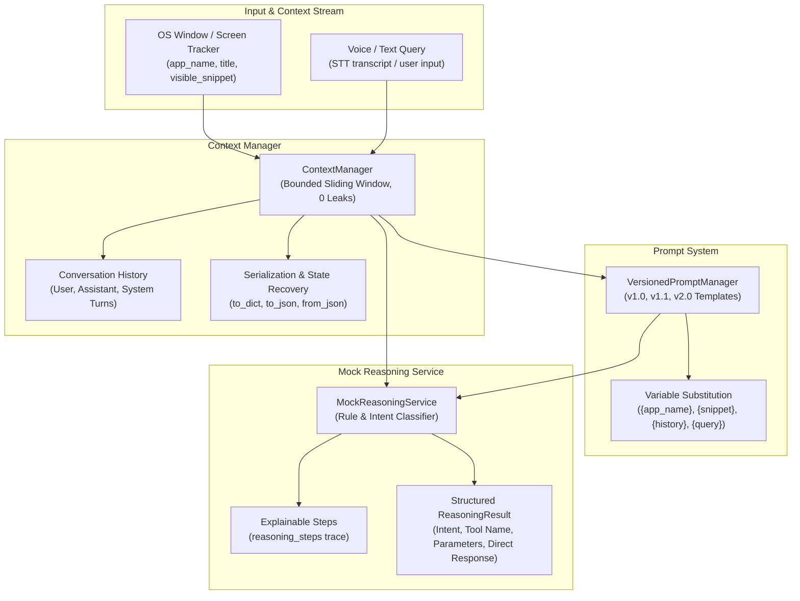

# Context & Reasoning Module

The **Context & Reasoning** module establishes multimodal context tracking, versioned prompt template management, and simulated LLM decision-making for the SDK-9 AI Voice Co-Pilot.

---

## 🏛️ Architecture & Component Overview



---

## 📦 Core Components

### 1. Domain Models (`models.py` & `types.ts`)
- **`WindowContext`**: Tracks active operating system window context (e.g. `VS Code`, `Chrome`), focused file titles, application category, and visible code/document snippets.
- **`ConversationTurn`**: Represents an individual dialogue turn (`user`, `assistant`, `system`) with unique ID, timestamp, and optional metadata.
- **`ConversationContext`**: Complete snapshot of session state, active window, turn history, and latest user query.
- **`VersionedPromptTemplate`**: Immutable version-controlled prompt templates with auto-extracted placeholder variables.
- **`ReasoningResult`**: Structured decision output with classified intent, tool execution requirements, extracted arguments, direct user responses, calibrated confidence (0.0–1.0), and explainable reasoning traces.

### 2. Context Manager (`context_manager.py`)
- **Sliding History Window**: Maintains conversation turns with configurable `max_turns` limit to prevent memory bloat during long sessions.
- **Active Window Synchronization**: Live updates for focused applications, window titles, and visible screen snippets.
- **Serialization & Deserialization**: Robust state saving and recovery through `to_dict()`, `to_json()`, `from_dict()`, and `from_json()`.
- **Dialogue Transcript Generation**: Generates clean, formatted multi-turn transcripts for LLM prompt injection (`get_history_summary()`).

### 3. Versioned Prompt Manager (`prompt_manager.py`)
- **Built-in Templates**:
  - `v1.0`: Standard contextual prompt with active application, snippet, history, and query.
  - `v1.1`: Tool-oriented reasoning prompt defining tool schemas (`file.search`, `file.move`, `calc.evaluate`).
  - `v2.0`: Autonomous agent prompt integrating Safety Levels A–D guidelines.
- **Safe Variable Interpolation**: Uses placeholder fallbacks to ensure templates never crash if variables are omitted.
- **Dynamic Registration**: Allows runtime registration of custom versioned prompt templates with automatic variable extraction.

### 4. Mock Reasoning Service (`mock_reasoning.py`)
Deterministic, rule-based reasoning engine that classifies developer intent without external API costs or network latency:

| Intent | Trigger Keywords | Tool Triggered | Output Parameters / Response |
| :--- | :--- | :---: | :--- |
| `EXPLAIN_ERROR` | `error`, `traceback`, `exception`, `crash`, `fail`, `bug` | No | Contextual diagnostic explanation referencing active snippet |
| `FILE_SEARCH` | `search for`, `find file`, `locate file` | `file.search` | `{"pattern": "<pattern>", "directory": "."}` |
| `FILE_MOVE` | `move file`, `rename file`, `relocate` | `file.move` | `{"source": "<src>", "destination": "<dst>"}` |
| `CALCULATE` | `calculate`, `compute`, `evaluate`, `what is` | `calc.evaluate` | `{"expression": "<math_expr>"}` |
| `SUMMARIZE_CODE` | `summarize`, `explain this code`, `what does this do` | No | Direct structural summary of visible snippet |
| `GENERAL_CONVERSATION` | `hello`, `hi`, `help`, `who are you` | No | Co-pilot introductory and assistance message |
| `DEFAULT_CONVERSATION` | (General developer queries) | No | Helpful nominal status acknowledgement |

---

## ⚡ Quickstart & Usage

### Basic Python Usage:
```python
from packages.context_reasoning import (
    ContextManager,
    VersionedPromptManager,
    MockReasoningService,
)

# 1. Initialize Context Manager
cm = ContextManager(session_id="session-001", max_turns=50)

# 2. Update active application window and visible snippet
cm.update_active_window(
    app_name="VS Code",
    window_title="server.py - SDK-9",
    app_type="ide",
    visible_snippet="items = []\nx = items[0]  # IndexError",
)

# 3. Add user voice query
query = "Why did this IndexError happen?"
cm.add_turn("user", query)
ctx = cm.update_user_query(query)

# 4. Run Reasoning Service
reasoner = MockReasoningService()
decision = reasoner.reason(ctx)

print(f"Intent: {decision.intent}")
print(f"Response: {decision.direct_response}")
print(f"Confidence: {decision.confidence * 100:.1f}%")

# 5. Record Assistant response in history
cm.add_turn("assistant", decision.direct_response)

# 6. Render Prompt Template for downstream LLM
pm = VersionedPromptManager()
prompt = pm.render_prompt(
    version="v1.0",
    app_name=ctx.active_window.app_name,
    snippet=ctx.active_window.visible_snippet or "",
    query=ctx.user_query,
    history=cm.get_history_summary(),
)
```

---

## 🖥️ Interactive CLI Demonstration

The module includes an interactive terminal utility to test context updates, prompt rendering, and mock reasoning live:

### Automated Simulation Walkthrough:
```bash
python -m packages.context_reasoning.cli --simulate
```

### Interactive Console REPL:
```bash
python -m packages.context_reasoning.cli
```
*In the REPL, type queries freely, or use `:window <app_name>` to switch active application context.*

---

## 🧪 Testing & Verification

Unit and integration tests are isolated within `packages/context_reasoning/tests/`:

```bash
# Run unit and integration tests:
pytest packages/context_reasoning/tests/ -v

# Run with coverage report:
pytest packages/context_reasoning/tests/ --cov=packages/context_reasoning --cov-report=term-missing
```

### Test Suite Highlights:
- **37 test cases** covering models, context manager, prompt system, mock reasoning, and CLI.
- **99% code coverage**.
- Deep immutability and state serialization roundtrip checks.
- Bounded memory sliding-window verification.
