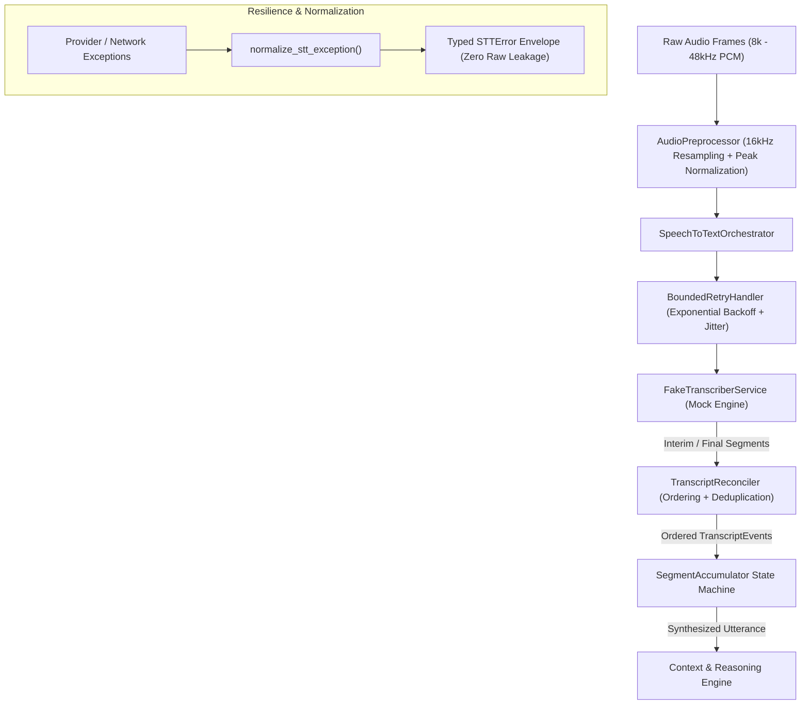

# Speech-to-Text & Segment Accumulator Module (`packages/speech_to_text/`)

> **Owner**: Pavanchand RM (Team Lead) · Branch: `feature/pavan-week3`  
> **Task**: Week 3 (Days 15–21) – Session Revision & Finalization, Confidence Thresholds, Cancellation, Fallback & Backend Event Stream Integration

---

## 1. Overview

The `speech_to_text` package provides the real-time transcription and streaming chunk aggregation layer for the SDK-9 AI Voice Co-Pilot. It converts raw and streamed 16-bit PCM audio frames into structured, chronologically ordered transcript segments, handles acoustic preprocessing (resampling to 16 kHz and amplitude normalization), protects callers with bounded retries and normalized error envelopes, suppresses duplicate segments, and manages the aggregation state machine to reconstitute complete user utterances without memory leaks.

---

## 2. Architecture & Pipeline Flow



---

## 3. Module Structure

```
packages/speech_to_text/
├── __init__.py          # Public API exports
├── models.py            # Pydantic schemas (TranscriptSegment, AccumulatedUtterance, TranscriptEvent)
├── preprocessor.py      # AudioPreprocessor (16kHz resampling, stereo downmixing, peak normalization)
├── exceptions.py        # Typed STTError hierarchy and error normalization
├── retry.py             # BoundedRetryHandler with exponential backoff & jitter
├── reconciler.py        # TranscriptReconciler (monotonic ordering, deduplication, interim revisions)
├── orchestrator.py      # SpeechToTextOrchestrator (end-to-end streaming lifecycle)
├── fake_transcriber.py  # Deterministic simulated STT service & dynamic confidence scoring
├── accumulator.py       # State-managed segment accumulator with out-of-order sorting
├── cli.py               # Interactive CLI demonstration tool
├── types.ts             # TypeScript interfaces for frontend parity
└── tests/
    ├── test_speech_to_text.py # Week 1 unit & accumulator tests (54 tests, 100% coverage)
    └── test_week2_stt.py      # Week 2 contract, preprocessor, retry, & orchestrator tests (24 tests)
```

---

## 4. Key Components (Week 2 Deliverables)

### A. Audio Preprocessor (`preprocessor.py`)
- **Resampling**: Uses high-fidelity linear interpolation to resample arbitrary input audio rates (e.g. 8 kHz, 44.1 kHz, 48 kHz) into the required 16,000 Hz target.
- **Stereo Downmixing**: Converts multi-channel audio to mono with sample averaging and boundary clamping.
- **Amplitude Normalization**: Peak amplitude scaling to target 0.90 of full scale (32767), boosting faint recordings while preventing digital clipping.

### B. Error Normalization (`exceptions.py`)
- Wraps all raw provider, network, and timeout exceptions into typed `STTError` subclasses:
  - `STTTimeoutError` (`STT_TIMEOUT`)
  - `STTProviderError` (`STT_PROVIDER_ERROR`)
  - `STTConnectionError` (`STT_CONNECTION_ERROR`)
  - `STTRateLimitError` (`STT_RATE_LIMIT`)
- Guarantees **zero raw provider exceptions leak** into client code.

### C. Bounded Exponential Retries (`retry.py`)
- Retries transient network/provider failures up to 3 times with exponential backoff and jitter.
- Differentiates retriable transient errors from non-retriable fatal payload corruption.

### D. Transcript Reconciler (`reconciler.py`)
- **Monotonic Chronological Ordering**: Ensures segments arriving out of order are sorted strictly by `start_time`.
- **Duplicate Suppression**: Fingerprints segments by content hash and sequence ID, silently dropping repeated packets.
- **Interim $\rightarrow$ Final Reconciliation**: Live partial drafts evolve as new words arrive, and are cleanly committed when the final segment arrives.

### E. STT Orchestrator (`orchestrator.py`)
- Manages the full lifecycle (`start`, `pause`, `resume`, `push_audio`, `flush`, `stop`).
- Converts continuous `AudioFrame` inputs into real-time `TranscriptEvent` streams.

---

## 5. Testing & Verification

```bash
# Run all Speech-to-Text unit & contract tests (78 tests, 100% pass)
.venv/bin/pytest packages/speech_to_text/tests/ -v

# Run coverage analysis for speech-to-text (98% coverage)
.venv/bin/pytest --cov=packages/speech_to_text packages/speech_to_text/tests/

# Run entire repository test suite (416 tests)
.venv/bin/pytest
```

---

## 6. TypeScript Interface Parity

[`types.ts`](./types.ts) provides complete TypeScript interfaces for frontend integration (`TranscriptSegment`, `AccumulatedUtterance`, `TranscriptEvent`, `STTErrorEnvelope`, `ISpeechToTextOrchestrator`).

---

## 7. Acceptance Criteria Verification (Week 2 & Week 3)

| Acceptance Criteria | Status | Verification Detail |
| :--- | :---: | :--- |
| **Interim results revised and finalized with clear events** | ✅ **PASSED** | Emits `transcript.interim`, `transcript.revised`, `transcript.final`, and `transcript.utterance` carrying `session_id`. |
| **Configurable confidence thresholds** | ✅ **PASSED** | Configurable `confidence_threshold` (default 0.65) and actions (`tag` or `filter`) flag low-confidence speech safely. |
| **Clean cancellation of in-flight transcription** | ✅ **PASSED** | `cancel()` halts streaming, clears pending audio and uncommitted drafts, transitions state to `CANCELLED`, and emits `transcript.cancelled`. |
| **Mock provider fallback on quota / network failures** | ✅ **PASSED** | Catches quota (429, ResourceExhausted) and network failures, normalizes errors, emits `transcript.fallback`, and seamlessly falls back to `FakeTranscriberService`. |
| **Audio events flow into transcription** | ✅ **PASSED** | Validated via `AudioSTTBridge` and direct `AudioFrame` ingestion in mock mode. |
| **Transcript events reach backend event stream** | ✅ **PASSED** | `TranscriptEventBridge` delivers live transcript events into backend `EventService` and SSE stream. |
| **Tests cover out-of-order and missing chunks** | ✅ **PASSED** | Verified disordered sequence handling and gap tracking (`missing_chunks_count`, `out_of_order_chunks_count`). |
| **Pass with no real provider or API key** | ✅ **PASSED** | All tests run 100% offline in deterministic mock mode without API keys or external services. |
| **No duplicate schemas & contracts defined once** | ✅ **PASSED** | Reuses core schemas in `models.py` with TypeScript parity in `types.ts`. |
