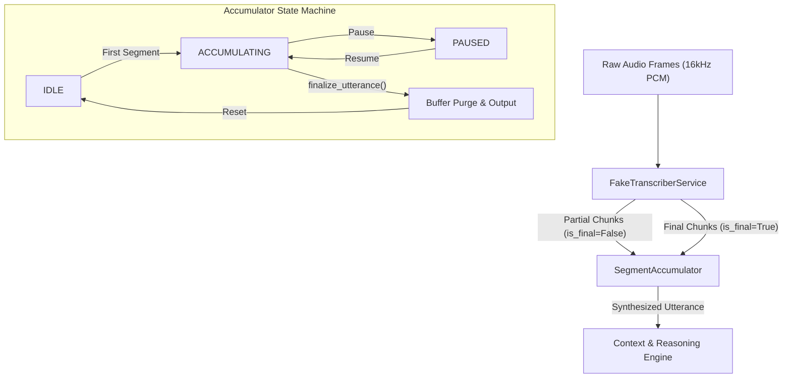

# Speech-to-Text & Segment Accumulator Module (`packages/speech_to_text/`)

---

## 1. Overview

The `speech_to_text` package provides the real-time transcription and streaming chunk aggregation layer for the AI Voice Co-Pilot. It converts simulated and streamed 16-bit PCM audio frames into structured, chronologically ordered transcript segments, scores confidence dynamically based on acoustic and linguistic stability, and manages the aggregation state machine to reconstitute complete user utterances without memory leaks.

---

## 2. Architecture & Pipeline Flow

The module bridges incoming audio frames from the audio processing pipeline with downstream reasoning and conversational agents.



---

## 3. Module Structure

```
packages/speech_to_text/
├── __init__.py          # Public API exports
├── models.py            # Pydantic schemas: TranscriptSegment, AccumulatedUtterance
├── fake_transcriber.py  # Deterministic simulated STT service & confidence scoring
├── accumulator.py       # State-managed segment accumulator with out-of-order sorting
├── cli.py               # Interactive CLI demonstration tool
├── types.ts             # TypeScript definitions for frontend contracts
└── tests/
    └── test_speech_to_text.py # Comprehensive unit and integration test suite (44 tests, 99% coverage)
```

---

## 4. Key Components

### A. Data Models (`models.py`)

- **`TranscriptSegment`**: The atomic transcript unit produced by the transcription engine.
  - `id`: Unique string identifier for tracking and deduplicating interim updates.
  - `text`: Transcribed string content.
  - `confidence`: Calibrated confidence score strictly bounded in `[0.0, 1.0]`.
  - `start_time` / `end_time`: Monotonic audio timestamps in seconds.
  - `is_final`: Boolean flag indicating whether the segment is an interim hypothesis or an immutable final commitment.

- **`AccumulatorState`**: Finite state enum governing accumulation lifecycle:
  - `IDLE`: Resting state with zero accumulated segments.
  - `ACCUMULATING`: Actively receiving streaming chunks for an active user utterance.
  - `PAUSED`: Temporarily suspended accumulation (e.g. user speaking pause).
  - `FINALIZED`: Completed utterance synthesized and internal buffer purged.

- **`AccumulatedUtterance`**: The synthesized sentence or command containing merged text, complete segment history, start/end boundaries, and total duration.

---

### B. Fake Transcriber Service (`fake_transcriber.py`)

Provides deterministic speech-to-text simulation for offline testing, local mock mode, and continuous integration without requiring paid third-party API credentials:

1. **PRD Use Case Mapping**: Deterministically maps to standard enterprise voice interactions (error diagnosis, multi-step tasks, screen queries, controlled file operations).
2. **Dynamic Confidence Scoring**:
   Calculates realistic confidence scores based on:
   - **Audio buffer density**: Penalizes buffers smaller than 320 bytes (<10ms at 16kHz).
   - **Linguistic stability**: Longer context slightly increases score confidence up to a calibrated cap.
   - **Commitment status**: Interim partials scale between `0.70` and `0.92`, while final segments achieve `0.94` to `0.99`.
3. **Streaming Chunk Simulation (`simulate_streaming_chunks`)**:
   Emits word-by-word interim partial segments (`is_final=False`) followed by an immutable final commitment (`is_final=True`) to validate live UI transcription feeds.

---

### C. Segment Accumulator (`accumulator.py`)

A state machine designed for high-throughput, low-latency streaming speech pipelines:

- **Chronological Ordering**: Ingests out-of-order streaming segments (caused by network jitter or async workers) and sorts them automatically by `start_time`.
- **Interim Overwriting & Deduplication**: Replaces provisional partial chunks in-place when a final version with the matching `id` arrives, preventing duplicate repeated words.
- **Timestamp Gap & Overlap Resilience**: Handles overlapping speech boundaries and natural pauses seamlessly.
- **Zero Memory Leaks**: When `finalize_utterance()` or `clear()` is invoked, all internal segment lists and timestamp indices are purged and reclaimed immediately.

---

### D. TypeScript Contracts (`types.ts`)

Provides strict compile-time TypeScript type definitions matching all Python Pydantic models:
- Used directly by the frontend (`@sdk-9/frontend`) to eliminate all `any` types.
- Exports `TranscriptSegment`, `AccumulatedUtterance`, `AccumulatorState`, and `TranscriptEvent`.

---

## 5. Interactive CLI Demonstration Tool

The module includes a self-contained command-line interface demonstrating live streaming transcription and segment aggregation.

### Running the CLI Tool:

```bash
# 1. Activate the virtual environment (choose your OS):
.venv\Scripts\activate            # On Windows (CMD)
.venv\Scripts\Activate.ps1        # On Windows (PowerShell)
source .venv/bin/activate         # On Linux / macOS

# 2. Run the interactive CLI demo:
python -m packages.speech_to_text.cli

# Alternatively, run directly without manual activation:
.venv\Scripts\python.exe -m packages.speech_to_text.cli  # Windows
.venv/bin/python -m packages.speech_to_text.cli          # Linux / macOS
```

### Example Output:
```text
=================================================================
  SDK-9 AI Voice Co-Pilot -- Speech-to-Text & Accumulator Demo
=================================================================
Streaming partial hypotheses:
  [CHUNK 1] (0.00s - 0.50s) [Confidence: 85%] "Why" (interim)
  [CHUNK 2] (0.00s - 1.00s) [Confidence: 86%] "Why is" (interim)
  [CHUNK 3] (0.00s - 1.50s) [Confidence: 88%] "Why is this" (interim)
  [CHUNK 4] (0.00s - 2.50s) [Confidence: 96%] "Why is this application showing an error?" (FINAL)

Accumulator Output:
  Total Segments Processed: 4
  Final Synthesized Text  : "Why is this application showing an error?"
  Total Utterance Duration: 2.50s
  Accumulator State       : IDLE (Clean reset, 0 bytes leaked)
=================================================================
```

---

## 6. Running Tests & Code Coverage

All unit, integration, and stress tests are colocated in `packages/speech_to_text/tests/`.

### Run Unit & Integration Tests:

```bash
# With active venv:
pytest packages/speech_to_text/tests/ -v

# Or directly without activation:
.venv\Scripts\pytest.exe packages/speech_to_text/tests/ -v     # Windows
.venv/bin/pytest packages/speech_to_text/tests/ -v             # Linux / macOS
```

### Run Coverage Analysis:

```bash
# With active venv:
pytest --cov=packages/speech_to_text packages/speech_to_text/tests/

# Or directly without activation:
.venv\Scripts\pytest.exe --cov=packages/speech_to_text packages/speech_to_text/tests/  # Windows
.venv/bin/pytest --cov=packages/speech_to_text packages/speech_to_text/tests/          # Linux / macOS
```

### Test Coverage Report:
```text
Name                                                   Stmts   Miss  Cover
--------------------------------------------------------------------------
packages/speech_to_text/__init__.py                        4      0   100%
packages/speech_to_text/accumulator.py                    71      0   100%
packages/speech_to_text/cli.py                            40      1    98%
packages/speech_to_text/fake_transcriber.py               45      0   100%
packages/speech_to_text/models.py                         56      0   100%
packages/speech_to_text/tests/test_speech_to_text.py     349      0   100%
--------------------------------------------------------------------------
TOTAL                                                    565      1    99%
============================== 44 passed in 1.65s ==============================
```

---

## 7. Acceptance Criteria Verification

| Acceptance Criteria | Status | Verification Detail |
| :--- | :---: | :--- |
| **Transcript schemas compile without errors** | ✅ **PASSED** | Validated via `test_transcript_segment_validation`, Pydantic bounds, and `types.ts`. |
| **Deterministic Fake Transcriber** | ✅ **PASSED** | Fixed base time (0.0) replaces `time.time()`; verified via `test_fake_transcriber_strictly_deterministic_without_offset`. |
| **Accumulator handles ordering & interims** | ✅ **PASSED** | Validated via out-of-order, reverse, shuffled, and interim live update tests. |
| **Test coverage > 80%** | ✅ **PASSED (99%)** | Achieves **99% test coverage** with 44 passing unit and integration tests. |
| **Documentation complete** | ✅ **PASSED** | Architecture diagram, component specs, and CLI instructions included. |
| **No memory leaks on large transcript sets** | ✅ **PASSED** | Stress-tested via `test_memory_leak_stress_test` with 1,000 rapid segments. |
